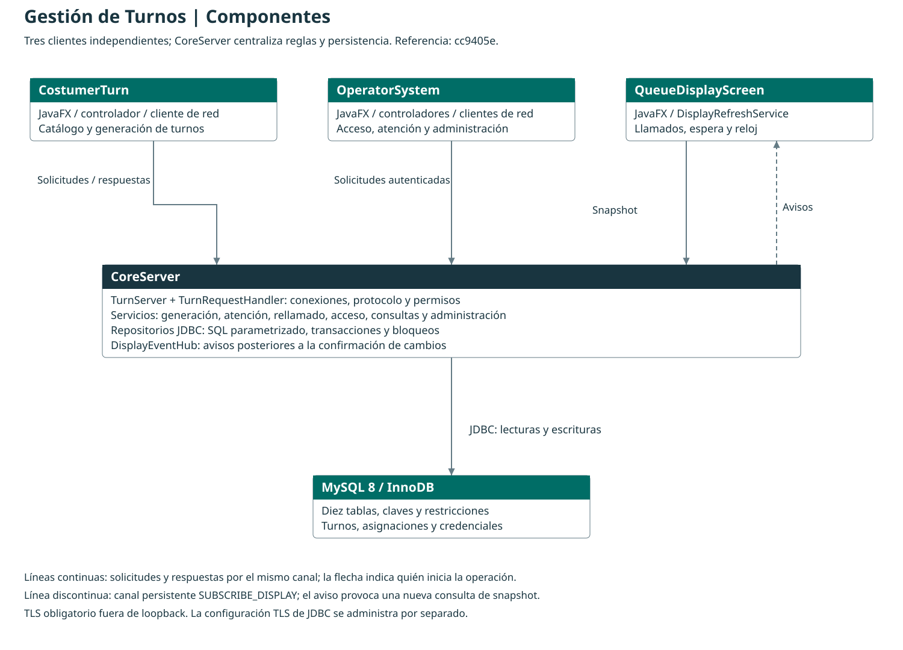
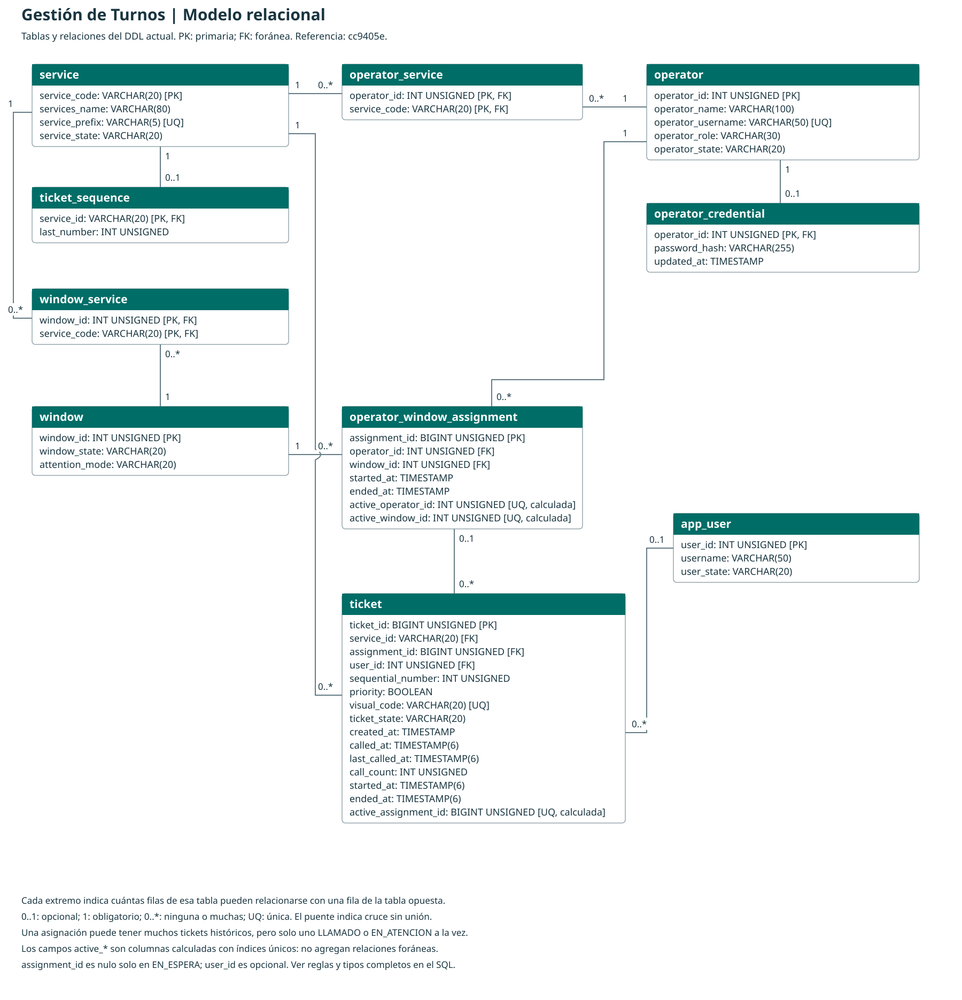

# Sistema distribuido de Gestión de Turnos

Documento técnico en elaboración. Este borrador desarrolla los apartados 3 a 11 de la estructura solicitada. Versión de referencia: `cc9405e`. La [lista de apartados y su estado](README.md) identifica el contenido restante.

## 3. Descripción del problema

Una institución que ofrece varios servicios necesita organizar a las personas que esperan atención y distribuirlas entre sus ventanillas. El sistema debe identificar el servicio solicitado, asignar un número de turno y comunicar cuándo y dónde será atendida cada persona.

La coordinación se vuelve más compleja cuando varios funcionarios trabajan simultáneamente. Si dos ventanillas solicitan el siguiente turno casi al mismo tiempo, solo una debe recibirlo. También debe evitarse que una ventanilla tenga dos turnos activos, que se asigne un servicio incompatible con el funcionario o que un turno finalizado vuelva a la cola como si fuera nuevo.

Las personas en espera necesitan ver los llamados sin depender de que alguien actualice manualmente la pantalla. Los funcionarios requieren conocer el estado de su ventanilla y del turno que están atendiendo. La administración necesita configurar las relaciones de atención y consultar posteriormente las operaciones realizadas.

La solución debe conservar los turnos, sus estados, responsables y fechas aun después de cerrar una aplicación. También debe manejar credenciales incorrectas, falta de turnos, operaciones no permitidas y pérdidas de conexión, mostrando información suficiente para que el usuario decida cómo continuar.

## 4. Descripción general de la solución

Se desarrolló un sistema cliente-servidor en Java, organizado en cuatro proyectos Maven. Tres aplicaciones JavaFX presentan las operaciones a las personas y a los funcionarios; un servidor central coordina las reglas, las sesiones, la comunicación y la persistencia en MySQL.

| Aplicación | Función |
| --- | --- |
| `CoreServer` | Recibe conexiones, procesa solicitudes, verifica permisos y reglas, ejecuta operaciones JDBC y avisa a las pantallas públicas cuando cambian los turnos. |
| `CostumerTurn` | Muestra los servicios disponibles, permite elegir atención regular o preferencial y confirma el código del turno generado. |
| `OperatorSystem` | Permite iniciar sesión, consultar asignaciones propias, llamar y rellamar, iniciar y finalizar atenciones, y pausar o reanudar la ventanilla. El perfil ADMIN dispone además de consultas y administración de personas y asignaciones. |
| `QueueDisplayScreen` | Muestra el último llamado y su ventanilla, llamados recientes, turnos en espera, reloj y estado de conexión. Se actualiza mediante avisos del servidor. |

### Recorrido de un turno

1. La persona selecciona un servicio y su tipo de atención en CostumerTurn.
2. CoreServer comprueba que el servicio esté activo y guarda el turno junto con la actualización del consecutivo de ese servicio en una misma transacción. El código combina el prefijo del servicio y el número; la prioridad se registra por separado.
3. Un funcionario autenticado solicita el siguiente turno de su asignación. El servidor comprueba la disponibilidad, la ocupación y los servicios que comparten el funcionario y la ventanilla.
4. Entre los turnos compatibles se atienden primero los preferenciales y, dentro de cada prioridad, se conserva el orden por fecha de creación e identificador. Una ventanilla exclusivamente preferencial no toma turnos regulares. Las mixtas pueden atender ambos tipos.
5. El turno pasa por `EN_ESPERA`, `LLAMADO`, `EN_ATENCION` y `FINALIZADO`. Las operaciones guardan sus fechas y mantienen la relación con la asignación que atendió a la persona.
6. Después de confirmar los cambios, el servidor avisa a las pantallas suscritas. Cada pantalla consulta una captura actualizada y la presenta automáticamente.

El rellamado conserva el mismo turno, su código y su primer llamado; actualiza el último llamado y el contador. La pausa impide nuevos llamados y permite completar la atención ya iniciada. La finalización conserva el historial y libera la ocupación de la asignación.

Las cinco consultas permiten revisar turnos atendidos entre fechas, cantidades por funcionario y por servicio, tiempos de espera y tiempos de atención. La espera se calcula desde la generación hasta el inicio de atención; la atención, desde el inicio hasta el fin.

La administración actual gestiona funcionarios, credenciales y usuarios relacionados con turnos, además de habilitaciones de servicios y apertura/cierre de asignaciones. El registro `app_user` no es una cuenta de acceso del personal; emitir un turno no exige registrar previamente a la persona.

**Alcance del corte:** la administración completa de servicios y ventanillas está pendiente de integrar. No se presenta como funcionalidad terminada. La política de prioridad es estricta y no garantiza un tiempo máximo de espera para los regulares. La atención preferencial con ventanilla exclusiva y apoyo de las mixtas es la característica elegida para desarrollar la justificación de innovación; PDF, QR y transferencias no forman parte de la implementación de este corte.

## 5. Arquitectura utilizada

La arquitectura combina la separación cliente-servidor con una organización por capas. Los cuatro proyectos se compilan por separado. Los clientes no se conectan a MySQL ni comparten una instancia Java de repositorio: intercambian mensajes con CoreServer. El servidor ensambla los servicios, los contratos de acceso a datos y sus implementaciones JDBC.

### Presentación

Las tres aplicaciones gráficas utilizan vistas FXML, estilos CSS y controladores JavaFX. Los controladores leen la entrada, coordinan solicitudes, muestran resultados y habilitan las acciones según el estado conocido. Las operaciones de entrada/salida se ejecutan fuera del hilo de la interfaz.

Por ejemplo, `TicketsGeneratorController` recibe las funciones necesarias para consultar servicios y generar turnos. Su cliente de red, `TurnServerClient`, prepara y procesa los mensajes. El controlador no calcula el consecutivo ni inserta directamente el ticket.

### Comunicación y coordinación

Los clientes de red traducen las operaciones de las pantallas al protocolo del servidor. `NetworkSettings` lee la dirección, el puerto y la configuración TLS dentro de cada aplicación. Sin configuración se permite la ejecución local en loopback; las conexiones fuera del equipo exigen TLS y validación del certificado del servidor.

En CoreServer, `TurnServer` acepta las conexiones y entrega las solicitudes a `TurnRequestHandler`. Los manejadores específicos de Personas y Asignaciones separan sus comandos administrativos. La autorización se comprueba en el servidor; la visibilidad de un botón no constituye un permiso.

La pantalla pública mantiene un canal de suscripción. `DisplayEventHub` distribuye avisos de cambios y `DisplayRefreshService` coordina la consulta de datos y la recuperación de la conexión. Los avisos no contienen una copia completa de la base: indican que debe consultarse su estado actualizado.

### Lógica de aplicación y modelos

Los servicios de CoreServer representan los casos de uso: generación, llamado, ciclo de atención, rellamado, disponibilidad, acceso, reportes y administración. Los modelos representan los datos y sus reglas, como `Ticket`, `Service`, `OperatorWindowAssignment` y los estados del turno.

`AuthService` y `SessionRegistry` controlan las sesiones y permisos. Las credenciales se guardan mediante hashes de contraseña; los tokens de sesión se mantienen en memoria del servidor. La relación entre cuenta, asignación y turno se vuelve a comprobar en las operaciones protegidas.

### Acceso a datos y persistencia

Los contratos de repositorio expresan lo que necesita cada caso de uso. Sus implementaciones `Jdbc...Repository` contienen SQL parametrizado, lecturas, transacciones, bloqueos y conversión de resultados. Las comprobaciones que deben permanecer válidas durante una escritura se repiten dentro de esa transacción, junto con la modificación de los datos.

Por ejemplo, `TicketService` depende del contrato `TicketCreationRepository`. `JdbcTicketCreationRepository` consulta el servicio, bloquea su consecutivo y registra el ticket antes de confirmar ambos cambios. Si la operación falla, revierte la transacción. Las restricciones de MySQL complementan ese control para impedir identidades u ocupaciones duplicadas.

Las implementaciones `InMemory` se conservan como apoyo para desarrollo y comprobaciones. El ensamblado actual de CoreServer utiliza JDBC para la generación y atención. No hay una única conexión MySQL compartida entre todos los hilos ni un pool de conexiones incorporado en este corte.

### Motivo de esta organización

La separación permite que todas las estaciones operen sobre las mismas reglas y datos, mientras cada cliente mantiene su responsabilidad. Centralizar la persistencia evita que cada pantalla gestione SQL, credenciales de MySQL y bloqueos por su cuenta. Los contratos permiten modificar el acceso a datos sin trasladar esas decisiones a los controles gráficos.

Los hilos mantienen la disponibilidad de las interfaces y del servidor, mientras que las transacciones, los bloqueos y las restricciones protegen la consistencia. Son responsabilidades distintas: ejecutar solicitudes en paralelo no garantiza por sí solo que dos operaciones no tomen el mismo turno.

La implementación utiliza MySQL 8, conforme a la autorización de uso comunicada por el equipo. La conexión entre aplicaciones y CoreServer, y la conexión JDBC hacia MySQL, se configuran por separado. El modo TLS de las aplicaciones no implica que se haya configurado el mismo transporte para JDBC.

### Referencias de implementación

- [Ensamblado de CoreServer](../CoreServer/src/main/java/cr/ac/una/CoreServer/App.java) y [arranque del generador](../CostumerTurn/src/main/java/cr/ac/una/costumerturn/App.java).
- [Servidor](../CoreServer/src/main/java/cr/ac/una/server/TurnServer.java), [manejador de solicitudes](../CoreServer/src/main/java/cr/ac/una/server/TurnRequestHandler.java) y [centro de avisos](../CoreServer/src/main/java/cr/ac/una/server/DisplayEventHub.java).
- [Servicio de generación](../CoreServer/src/main/java/cr/ac/una/service/TicketService.java), [contrato de creación](../CoreServer/src/main/java/cr/ac/una/repository/TicketCreationRepository.java) e [implementación JDBC](../CoreServer/src/main/java/cr/ac/una/repository/JdbcTicketCreationRepository.java).
- [Guía de instalación](../INSTALACION.md), [configuración de red](../RED_Y_TLS.md) y [esquema](../database/script%20borrador.sql).

## 6. Diagrama general de componentes

[Abrir imagen PNG](diagramas/componentes.png) · [Archivo editable en diagrams.net](diagramas/componentes.drawio).

Las flechas continuas indican qué componente inicia la operación; las respuestas vuelven por la misma conexión. CostumerTurn consulta el catálogo y solicita turnos. OperatorSystem envía solicitudes de acceso, atención, consulta y administración. QueueDisplayScreen consulta una captura del estado público y mantiene un canal adicional de suscripción.

El inicio de sesión ocurre antes de disponer de un token; las solicitudes protegidas posteriores incluyen la sesión autenticada. No se exige iniciar sesión para generar turnos o consultar la pantalla pública.

La flecha discontinua representa los avisos que CoreServer envía por ese canal persistente. Un aviso indica que hay cambios; la pantalla vuelve a consultar los datos. No se envía la base completa por cada evento ni se consulta MySQL desde la pantalla. Los latidos permiten conservar y comprobar el canal sin obligar a consultar los datos cada vez.

Dentro de CoreServer se distinguen el acceso de red, los casos de uso y los repositorios JDBC. Esa separación es interna: no representa tres servidores desplegados ni un quinto proyecto Java. Solo CoreServer dispone de la configuración JDBC.

El diagrama representa componentes lógicos, no la distribución física entre computadoras. Se pueden ejecutar varias instancias de los clientes. Las conexiones fuera de loopback requieren TLS; la seguridad del enlace JDBC se configura por separado. La prueba física entre computadoras permanece pendiente.

## 7. Diseño de la base de datos

El sistema utiliza MySQL 8 con tablas InnoDB. El [script de creación](../database/script%20borrador.sql) es la referencia para los tipos, nulabilidad, valores predeterminados, claves e índices completos. El diagrama corresponde al esquema actual de diez tablas; sustituye el modelo preliminar de seis tablas.

[Abrir imagen PNG](diagramas/base_datos.png) · [Archivo editable en diagrams.net](diagramas/base_datos.drawio).

### Responsabilidad de las tablas

| Tabla | Responsabilidad |
| --- | --- |
| `operator` | Identidad del funcionario, nombre de acceso, perfil y estado. |
| `operator_credential` | Hash de la contraseña y fecha de actualización, vinculados al funcionario. No almacena la contraseña original. |
| `service` | Código estable, nombre, prefijo y estado del servicio. |
| `operator_service` | Servicios para los que está habilitado cada funcionario. |
| `window` | Identificador, estado y modalidad de la ventanilla: mixta o exclusivamente preferencial. |
| `window_service` | Servicios habilitados para cada ventanilla. |
| `operator_window_assignment` | Ocupación histórica de una ventanilla por un funcionario, con inicio y fin. |
| `app_user` | Registro opcional de una persona relacionada con tickets; no es una cuenta de acceso del personal. |
| `ticket_sequence` | Último consecutivo reservado para cada servicio. |
| `ticket` | Identidad, servicio, código visual, prioridad, estado, asignación, usuario opcional y fechas del turno. Incluye primer/último llamado y contador. |

### Lectura de las relaciones

En el diagrama, la multiplicidad se coloca junto a la tabla que describe. Por ejemplo, `operator 1 — 0..* operator_service` significa que un funcionario puede tener cero o muchas habilitaciones y cada habilitación pertenece a exactamente un funcionario.

| Tabla de referencia | Multiplicidad junto a ella | Tabla que contiene la FK | Multiplicidad junto a ella | Clave foránea |
| --- | --- | --- | --- | --- |
| `operator` | 1 | `operator_credential` | 0..1 | `operator_id` |
| `operator` | 1 | `operator_service` | 0..* | `operator_id` |
| `service` | 1 | `operator_service` | 0..* | `service_code` |
| `window` | 1 | `window_service` | 0..* | `window_id` |
| `service` | 1 | `window_service` | 0..* | `service_code` |
| `operator` | 1 | `operator_window_assignment` | 0..* | `operator_id` |
| `window` | 1 | `operator_window_assignment` | 0..* | `window_id` |
| `service` | 1 | `ticket_sequence` | 0..1 | `service_id` |
| `service` | 1 | `ticket` | 0..* | `service_id` |
| `operator_window_assignment` | 0..1 | `ticket` | 0..* | `assignment_id` |
| `app_user` | 0..1 | `ticket` | 0..* | `user_id` |

Las once relaciones corresponden a claves foráneas reales. Un cruce de líneas no añade una relación; el puente visual indica que los conectores pasan sin unirse. `PK` identifica la clave primaria, `FK` una foránea y `UQ` una restricción única de una columna. La unicidad compuesta por servicio y número se explica debajo.

### Relaciones múltiples y conservación del historial

`operator_service` y `window_service` resuelven relaciones muchos a muchos. Sus claves primarias compuestas impiden repetir la misma pareja. La atención de un servicio exige que esté habilitado tanto para el funcionario como para la ventanilla; no basta con uno de los dos enlaces.

`operator_window_assignment` representa una ocupación a lo largo del tiempo. Un funcionario y una ventanilla pueden aparecer en muchas asignaciones históricas, pero cada uno puede tener como máximo una abierta. Cerrar una asignación registra su fin; ocupar de nuevo la ventanilla crea otra fila.

El ticket referencia esa asignación para obtener el funcionario y la ventanilla que lo atendieron. Así, cambiar después al ocupante de una ventanilla no cambia el responsable de los tickets anteriores. Esta relación conserva identidades históricas; no implica que se guarde una copia inmutable de cada nombre del catálogo.

La asignación del ticket es opcional únicamente mientras está `EN_ESPERA`; los estados `LLAMADO`, `EN_ATENCION` y `FINALIZADO` la exigen mediante un CHECK. La relación con `app_user` es opcional en todos los estados. La emisión actual no completa automáticamente `user_id`.

Un servicio puede tener como máximo una fila en `ticket_sequence`. La FK no obliga a crearla: la instalación inicial la prepara y la generación rechaza un servicio sin consecutivo. La futura administración de servicios debe conservar esta condición y no reiniciar números existentes.

### Restricciones e integridad

- El código visual del ticket es único. También lo es la pareja `(service_id, sequential_number)`, cuyo número debe ser positivo.
- El prefijo del servicio y el nombre de acceso del funcionario tienen restricciones únicas. `app_user.username` no tiene un índice único en el DDL actual; la administración comprueba sus duplicados en su recorrido transaccional.
- Las columnas calculadas `active_operator_id` y `active_window_id` solo tienen valor en asignaciones abiertas. Sus índices únicos impiden dos asignaciones abiertas para un mismo funcionario o una misma ventanilla.
- `active_assignment_id` solo tiene valor en tickets `LLAMADO` o `EN_ATENCION`; su índice único limita a uno el turno activo de cada asignación. Los tickets finalizados permanecen como historial.
- Los CHECK restringen estados, modalidad, prioridad, asociación y presencia/orden de fechas. Las columnas calculadas no son FK adicionales.
- Las FK conservan las referencias. La aplicación utiliza bajas lógicas y rechaza cambios incompatibles, en lugar de borrar el historial para resolver dependencias.

Los datos de cada funcionario, servicio y ventanilla se conservan en su tabla correspondiente. Las habilitaciones y las ocupaciones históricas se representan mediante relaciones, evitando repetir listas de servicios o los datos completos del funcionario dentro del ticket. `visual_code` y las columnas calculadas son redundancias controladas para identificación y restricciones; no representan nuevas entidades.

Las claves foráneas aseguran existencia, pero no comprueban por sí solas actividad, permisos ni compatibilidad. Esas reglas se verifican en el servidor dentro de sus operaciones transaccionales, junto con los bloqueos necesarios.

### Fechas, rellamado e instalación

El ticket guarda creación, primer llamado, último llamado, inicio y fin. Las cuatro fechas de atención usan `TIMESTAMP(6)`; creación y fechas de asignación mantienen precisión de segundos. El rellamado conserva primer llamado, último llamado y contador, sin una fila independiente por cada repetición. Tampoco existe una bitácora individual de cada alta o baja de habilitación.

Para una instalación nueva se ejecutan el esquema y los [datos iniciales](../database/datos_prueba.sql). Para una base anterior se revisan las [migraciones](../database/migraciones), sin reinicializar datos ni contadores. El procedimiento reproducible está en [INSTALACION.md](../INSTALACION.md).

Los dos diagramas se contrastaron con el corte `cc9405e`. Deben comprobarse otra vez al integrar los cambios de servicios y ventanillas; no representan por anticipado esa implementación.

## 8. Descripción de los patrones utilizados

### MVC: separar la presentación de sus datos y operaciones

**Problema:** si una pantalla calcula consecutivos, ejecuta SQL y modifica controles, un cambio de almacenamiento o de regla obliga a modificar también la interfaz. Además, distintas estaciones podrían aplicar reglas diferentes.

**Aplicación:** las vistas FXML y los estilos describen la presentación; los controladores JavaFX coordinan entradas y resultados; los modelos representan los datos. Por ejemplo, `ticketsGenerator.fxml`, `TicketsGeneratorController`, `ServiceOption` y `TicketConfirmation` forman parte de esa separación en CostumerTurn. Las reglas compartidas y los modelos del dominio, como `Ticket`, se encuentran en CoreServer. El cliente recibe datos por red; no comparte la misma instancia del modelo del servidor.

**Beneficio:** se puede modificar la presentación sin trasladar SQL al controlador, y todos los clientes utilizan las reglas del servidor. Es una aplicación de MVC dentro de una arquitectura distribuida, no una afirmación de que las cuatro aplicaciones compartan un único objeto modelo.

### Repository: separar el caso de uso del almacenamiento

**Problema:** la generación necesita guardar un turno y reservar su número, pero no debería contener directamente la implementación SQL dentro de la pantalla o del servicio de entrada.

**Aplicación:** `TicketService` recibe por constructor un `TicketCreationRepository`, cuyo contrato ofrece `createWithNextNumber`. El ensamblado de CoreServer entrega una instancia de `JdbcTicketCreationRepository`. Esa implementación contiene la transacción que consulta el servicio, bloquea el consecutivo, inserta el ticket y actualiza el número.

**Beneficio:** el servicio depende de una operación del dominio y de un contrato, mientras la implementación JDBC concentra los detalles del almacenamiento. Existen contratos equivalentes para llamado, ciclo, rellamado, consultas y administración. Las implementaciones InMemory de apoyo no significan que todos los contratos dispongan de un sustituto intercambiable ya terminado.

### Publicación/suscripción y el principio de Observer

**Problema:** varias pantallas deben actualizarse cuando cambia la atención, sin que cada operación conozca qué ventanas están abiertas ni espere a que cada una dibuje los datos.

**Aplicación:** `DisplayEventHub` registra suscripciones y publica un aviso después de confirmar un cambio. `TurnServer` transmite el aviso al suscriptor y `DisplayRefreshService` consulta una captura actualizada. Cada suscripción tiene una cola de capacidad uno: varios cambios próximos pueden agruparse, porque interesa recuperar el estado vigente y no reproducir cada aviso como una operación histórica.

**Beneficio:** el productor del cambio no administra las interfaces de cada pantalla. Es publicación/suscripción con una finalidad relacionada con Observer; no se utiliza la clase `java.util.Observable` ni un callback remoto de objetos Java. MVC y Repository constituyen los dos patrones principales justificados aquí.

## 9. Explicación del mecanismo de comunicación

Las aplicaciones intercambian mensajes de texto UTF-8 sobre sockets TCP. `NetworkSettings` prepara el transporte y la configuración de cada proyecto. Las conexiones fuera de loopback exigen TLS, confianza en el certificado y coincidencia de su nombre o IP. La configuración y los certificados se describen en [RED_Y_TLS.md](../RED_Y_TLS.md).

### Solicitudes y respuestas

El protocolo separa los campos mediante punto y coma. Los textos variables se codifican con `URLEncoder` y se recuperan con `URLDecoder` usando UTF-8, para que un separador o un acento no altere la estructura. Esta codificación no cifra el contenido: esa protección corresponde a TLS.

Cada solicitud normal abre una conexión, envía una línea, recibe una respuesta y cierra el canal. El canal de suscripción pública es persistente y se describe aparte.

| Forma de solicitud | Uso |
| --- | --- |
| `LIST_SERVICES` | Catálogo público. |
| `GENERATE_TICKET;INFO;true` | Generación preferencial para el servicio de ejemplo INFO. |
| `LOGIN;usuario;contraseña` | Inicio de sesión; los textos se envían codificados. |
| `AUTH;<token>;CALL_NEXT;<asignacion>` | Operación protegida de atención sobre una asignación propia. |
| `AUTH;<token>;RECALL_TICKET;<asignacion>;<ticket>` | Rellamado del ticket actual. |
| `AUTH;<token>;REPORT_*;...` | Consultas disponibles para ADMIN. |
| `AUTH;<token>;ADMIN_PEOPLE_*;...` o `ADMIN_ROUTING_*;...` | Administración de personas y configuración de atención. Ambas familias llevan el prefijo AUTH. |

`TurnRequestHandler` interpreta los comandos, verifica permisos y deriva la operación al servicio correspondiente. Las respuestas `OK;...` describen resultados correctos; `ERROR;...` informa rechazos de formato, reglas o acceso a datos; `DENIED;motivo;mensaje` distingue los rechazos de autenticación o autorización. Un resultado válido también puede indicar que no hay turnos disponibles.

Los identificadores enviados por el cliente no acreditan su propiedad. El servidor obtiene el funcionario de la sesión, comprueba su asignación y exige ADMIN donde corresponde. Los contratos detallados se mantienen en las guías de [acceso](../database/INICIALIZAR_ACCESO.md), [Personas](../database/ADMINISTRAR_PERSONAS.md), [Asignaciones](../database/CONFIGURAR_ATENCION.md) y [rellamado](../database/RELLAMADO.md).

### Actualización de la pantalla pública

La pantalla envía `SUBSCRIBE_DISPLAY`. El servidor confirma con `OK;SUBSCRIBED`, emite `EVENT;DISPLAY_CHANGED` cuando hay cambios y envía `OK;HEARTBEAT` después de diez segundos sin avisos. El latido no obliga a consultar los datos.

`DisplayRefreshService` abre la suscripción antes de solicitar la captura inicial para conservar un aviso que llegue durante esa lectura. Después consulta `GET_DISPLAY_SNAPSHOT_V2` cuando recibe cambios. V2 incluye primer llamado, último llamado y contador; el comando anterior conserva su formato para las herramientas existentes.

Si la conexión falla, la pantalla conserva los datos visibles, indica que están desactualizados e intenta volver a suscribirse después de dos segundos. Al recuperar el canal vuelve a consultar una captura completa. Los avisos viven en memoria y no son una bitácora durable; SQL ejecutado directamente en MySQL no publica notificaciones del servidor.

### Confirmaciones perdidas

Una espera agotada no demuestra que la transacción falló: pudo guardarse el cambio y perderse únicamente la respuesta. Los clientes no repiten automáticamente las escrituras. La pantalla del operador consulta el turno activo para recuperar contexto; una finalización incierta requiere comprobar el historial, porque una asignación libre no acredita por sí sola esa finalización concreta.

En la generación tampoco existe una clave de idempotencia que reconozca una solicitud repetida. El aviso pide comprobar el resultado antes de solicitar otro turno. La consulta y la recuperación de conexión son distintas de reenviar una modificación.

## 10. Explicación del uso de hilos

El servidor y las interfaces deben poder esperar conexiones, respuestas y consultas sin detener a todos los demás usuarios. Se utilizan hilos virtuales para gran parte de ese trabajo de entrada/salida; la actualización de controles sigue perteneciendo al hilo de JavaFX.

| Lugar del código | Trabajo | Motivo |
| --- | --- | --- |
| `TurnServer.start` | Acepta conexiones y entrega cada cliente a `Executors.newVirtualThreadPerTaskExecutor()`. | Una conexión o suscripción puede esperar sin mantener ocupado el ciclo que acepta otros clientes. |
| `TicketsGeneratorController.startTask` | Ejecuta un `Task` mediante `Thread.ofVirtual()`. | El catálogo y la emisión no bloquean la interfaz mientras esperan al servidor. |
| Controladores de acceso, atención, consultas, Personas y Asignaciones | Ejecutan sus tareas de red en hilos virtuales. | Mantienen la interfaz disponible y coordinan controles mientras una solicitud está en curso. |
| `DisplayRefreshService` | Mantiene la escucha y consulta capturas en un ejecutor de hilos virtuales. | La espera del siguiente evento o de una reconexión no detiene el reloj ni el dibujo de la pantalla. |
| `OperatorSystem.App.stop` | Inicia un hilo de plataforma no daemon para intentar LOGOUT con tiempos acotados. | Permite intentar el aviso de cierre sin hacer esperar al hilo de interfaz. No se promete revocación si el aviso falla. |

En la pantalla pública, `Platform.runLater` traslada los resultados al hilo JavaFX. El reloj utiliza `Timeline`; no se crea un hilo de red adicional por cada segundo mostrado. Los manejadores de finalización de los `Task` coordinan la presentación de resultados y errores.

Al cerrar una pantalla pública se detiene el reloj, se cancela su trabajo y se cierra la suscripción. `DisplayRefreshService.close` señala el cierre, interrumpe el ejecutor y cierra el canal activo. Los controladores cancelan su trabajo pendiente y evitan aplicar resultados a vistas ya cerradas.

Se comparten entre solicitudes el manejador, los servicios, los repositorios, el registro de sesiones y el centro de avisos del servidor. Las transacciones utilizan conexiones JDBC propias de la operación; no se comparte una única `Connection` entre todos los hilos. `ConnectionMetrics` utiliza `ThreadLocal` para separar las mediciones de solicitudes simultáneas. El conjunto de suscripciones y sus colas emplean colecciones concurrentes.

Los hilos permiten concurrencia, pero no resuelven automáticamente las carreras sobre turnos, consecutivos o asignaciones. Esa protección se explica en el apartado siguiente.

## 11. Explicación del control de concurrencia

La consistencia se protege mediante transacciones, bloqueos y restricciones de MySQL. Deshabilitar un botón reduce solicitudes accidentales en una ventana, pero no impide que otro proceso envíe la misma operación.

### Reserva del consecutivo

`JdbcTicketCreationRepository` inicia una transacción, lee el servicio activo con `FOR SHARE` y bloquea la fila correspondiente de `ticket_sequence` con `FOR UPDATE`. Después crea el ticket y actualiza el consecutivo. Confirma ambos cambios juntos; ante un fallo, ejecuta rollback. Las restricciones de código visual y de servicio/número constituyen una segunda defensa.

Dos solicitudes para el mismo servicio no calculan el siguiente número desde copias independientes de un contador local: compiten por la fila protegida del servicio.

### Dos llamados simultáneos

`JdbcTicketCallingRepository` vuelve a comprobar la asignación dentro de su transacción. Bloquea la asignación, el funcionario y la ventanilla; comprueba sus estados y la compatibilidad de servicios; verifica que no exista una ocupación activa incompatible.

La selección busca tickets `EN_ESPERA` de servicios elegibles, aplica la modalidad de la ventanilla y ordena por prioridad descendente, fecha de creación e identificador. Utiliza `LIMIT 1 FOR UPDATE` y actualiza el registro con una condición adicional que exige que siga en espera. No utiliza `SKIP LOCKED` ni un bloqueo global de toda la cola en memoria.

Si dos ventanillas compiten por el mismo candidato, los bloqueos coordinan el acceso y la segunda operación no puede confirmar ese ticket como otro llamado válido después de que ya salió de espera. Puede recibir otro turno compatible o informar que no hay turnos; una contención o error de transacción se informa sin un reenvío automático de escritura.

Los índices únicos de asignaciones abiertas y del turno activo complementan esta coordinación. Una misma asignación no puede conservar dos tickets llamados o en atención, y un funcionario o una ventanilla no pueden tener dos asignaciones abiertas.

### Ciclo, rellamado y administración

El inicio y la finalización bloquean la asignación y el ticket y comprueban identidad y estado antes de actualizar. El rellamado bloquea asignación, funcionario, ventanilla y ticket para conservar la ocupación, incrementar el contador y actualizar la última fecha de forma atómica. Una pausa o un inicio concurrente no se resuelven confiando únicamente en el estado que mostraba el botón.

La administración de Personas vuelve a validar al administrador dentro de la transacción y serializa las escrituras mediante un orden común de bloqueo de cuentas ADMIN. Esto permite proteger el último administrador con acceso y coordinar las bajas con las asignaciones.

Las modificaciones de habilitaciones y asignaciones utilizan además `RoutingConfigurationLock`: un bloqueo nombrado por base obtenido con `GET_LOCK`, con espera máxima de cinco segundos y liberación al salir. Serializa esos cambios administrativos entre sí; no reemplaza los bloqueos de filas ni obliga a que el llamado normal lo adquiera. Sus escrituras utilizan `READ_COMMITTED`; las capturas coherentes de la pantalla pública y de la configuración administrativa utilizan `REPEATABLE_READ`.

No existe un único orden universal de todas las tablas para todas las operaciones. La apertura de una asignación aún no tiene una fila propia; la retirada de una habilitación evita adquirir después una asignación en orden inverso al llamado. Los cambios futuros deben mantener esos acuerdos. El detalle está en [CONFIGURAR_ATENCION.md](../database/CONFIGURAR_ATENCION.md).

### Confirmación, eventos y evidencia

Las operaciones publican el aviso público después de confirmar el cambio. Las colas de avisos usan `offer`, con capacidad uno por suscripción, para que una pantalla lenta no obligue a esperar a la operación de negocio. No hay una transacción distribuida entre MySQL y los sockets; el estado persistido es la referencia para recuperar los datos.

La evidencia incluye emisiones y llamados concurrentes, solicitudes sobre una misma asignación, rollback y conflictos de pausa, rellamado y administración. Se conserva por versión en [QA integral](../pruebas/QA_2026-11-12.md), [rellamado](../pruebas/QA_rellamado_2026-11-12.md), [Personas](../pruebas/QA_personas_2026-11-12.md) y [Asignaciones](../pruebas/QA_asignaciones_2026-11-12.md). Las [herramientas concurrentes](../pruebas/README.md) documentan su preparación y alcance.

Los casos de regresión repetidos no se suman como pruebas diferentes. Estos resultados no prueban carga prolongada, ausencia de todo interbloqueo ni la integración de código todavía no recibido. Falta contrastar la administración de servicios y ventanillas, completar el ensayo físico entre computadoras y medir el rendimiento remoto.

### Ubicación del código explicado

- [Controlador del generador](../CostumerTurn/src/main/java/cr/ac/una/costumerturn/controller/TicketsGeneratorController.java), [contrato de creación](../CoreServer/src/main/java/cr/ac/una/repository/TicketCreationRepository.java) y [repositorio JDBC](../CoreServer/src/main/java/cr/ac/una/repository/JdbcTicketCreationRepository.java).
- [Servidor y ejecutor](../CoreServer/src/main/java/cr/ac/una/server/TurnServer.java), [centro de avisos](../CoreServer/src/main/java/cr/ac/una/server/DisplayEventHub.java) y [escucha pública](../QueueDisplayScreen/src/main/java/cr/ac/una/QueueDisplayScreen/service/DisplayRefreshService.java).
- [Llamado](../CoreServer/src/main/java/cr/ac/una/repository/JdbcTicketCallingRepository.java), [ciclo](../CoreServer/src/main/java/cr/ac/una/repository/JdbcTicketLifecycleRepository.java), [rellamado](../CoreServer/src/main/java/cr/ac/una/repository/JdbcTicketRecallRepository.java) y [bloqueo administrativo](../CoreServer/src/main/java/cr/ac/una/repository/RoutingConfigurationLock.java).
